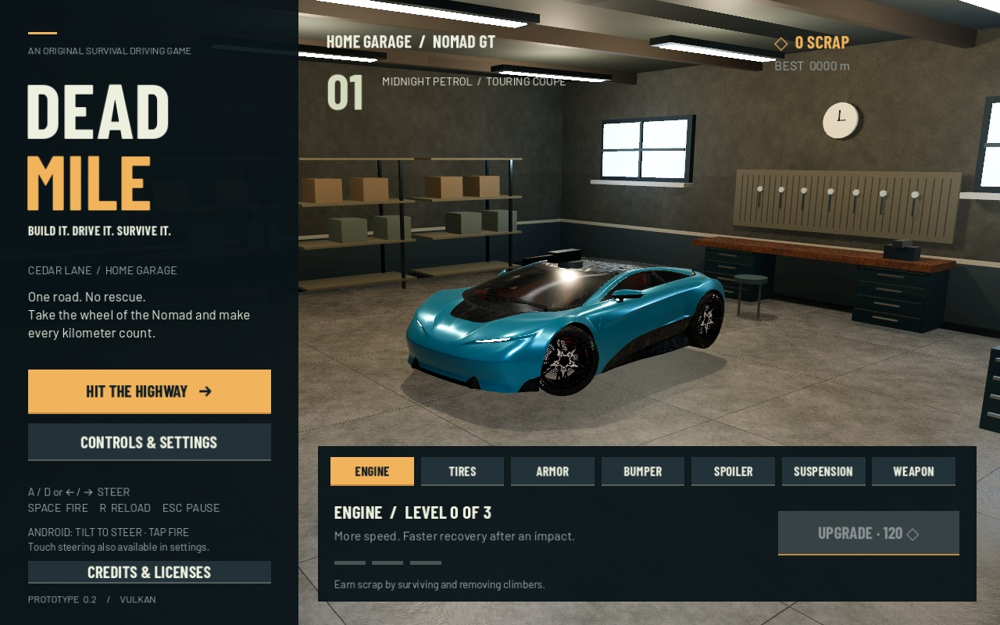

# Dead Mile

An original Android-first survival driving prototype, inspired by the driving rhythm of Zombie Highway and the vehicle progression of Earn to Die. Built with **Godot 4.6.3**, typed GDScript, detailed licensed car geometry and physically based materials.

The current slice includes one touring coupe, a recycled desert highway, wreck collisions, light/heavy zombie climbers, shooting/reloading, side scraping, roll pressure, pause/retry, and a persistent garage with seven upgrade categories. Version 0.2 adds a realistic automotive direction: clear-coat metallic paint, local reflections, a furnished home garage, textured surfaces and Vulkan rendering. This is an early playable prototype; production characters, the full weapon roster, tutorial and phone tuning remain ahead.

## Download for Android

[**Download Dead Mile 0.2.0 APK**](https://github.com/vdwMarius/zombie-highway-reimagined/raw/refs/heads/builds/dead-mile-v0.2.0-android-arm64.apk)

[ZIP alternative](https://github.com/vdwMarius/zombie-highway-reimagined/raw/refs/heads/builds/dead-mile-v0.2.0-android-arm64.zip) · [Checksums and install notes](https://github.com/vdwMarius/zombie-highway-reimagined/tree/builds)

These are GitHub-hosted files, not cloud-local workspace links. The build is debug-signed for 64-bit Android phones. The high graphics preset targets recent Vulkan phones, initially the Samsung Galaxy S26 Ultra; physical-device validation is still required. If your browser blocks the APK file type, download the ZIP and extract the APK.



## Run

Open `project.godot` in Godot 4.6.3 and press F6/F5, or run:

```sh
bash tools/godot.sh --editor --import
# Run directly:
bash tools/godot.sh
```

In a cloud shell without a display, use the headless checks below. A rendered run needs a real display or X server. The wrapper keeps Godot's settings, cache and saves in writable local directories; it uses `/workspace/tooling` in this prepared environment and `.local-dev` elsewhere.

## Controls

| Action | Desktop | Android |
| --- | --- | --- |
| Steering | A/D or arrow keys | Landscape tilt or hold bottom left/right zones |
| Shoot | Space or FIRE button | FIRE button |
| Reload | R or RELOAD button | RELOAD button |
| Pause | Esc | Pause button / Android Back |
| Calibrate | On-screen button | Hold phone comfortably, then tap CALIBRATE |

The roof weapon automatically prioritizes attached/heavy climbers in this prototype. Scrape a side close to a wreck to remove climbers on that side. A direct hit damages the hull. Countersteer when attackers build up on one side. Settings include tilt enable/disable, sensitivity, recalibration and audio mute. Progress saves automatically; debug builds start with zero scrap.

## Check

```sh
bash tools/godot.sh --headless --editor --import --quit
bash tools/godot.sh --headless --script tests/smoke.gd -- --test
# Requires an X display; captures garage/driving in ignored test-results/:
bash tools/godot.sh --audio-driver Dummy --script tests/smoke.gd -- --test --capture
```

Rendered checks require Vulkan; use the commands in development notes on the prepared cloud machine. Smoke tests isolate player persistence and exercise actual run state, steering, collisions, climber attachment/combat, rewards, saves and retries. Real Android sensor behavior and performance require a phone.

## Android debug build

This cloud instance has verified official Godot 4.6.3 Android export templates and Google's Android SDK installed outside the checkout. See [development notes](docs/DEVELOPMENT.md) for exact locations and setup requirements.

```sh
bash tools/godot.sh --headless --export-debug Android builds/dead-mile-v0.2.0-android-arm64.apk
```

The preset produces a signed **debug** APK for ARM64 phones, minimum Android 7 / API 24, target API 36, with Vulkan graphics. It does not request Internet permission. Install manually on a phone, or use `adb install -r builds/dead-mile-v0.2.0-android-arm64.apk` when a device is connected and authorized. Release signing, AAB packaging and Play Store distribution are not configured.

Read the [game plan](docs/GAME_PLAN.md) for the intended scope, delivery gates and architecture direction, and [asset provenance](assets/LICENSES.md) for licenses.

## Art credits

Car Concept: Eric Chadwick / Darmstadt Graphics Group GmbH, CC BY 4.0, adapted for Dead Mile. Complete attribution is available in the in-game Credits screen and [asset provenance](assets/LICENSES.md).
